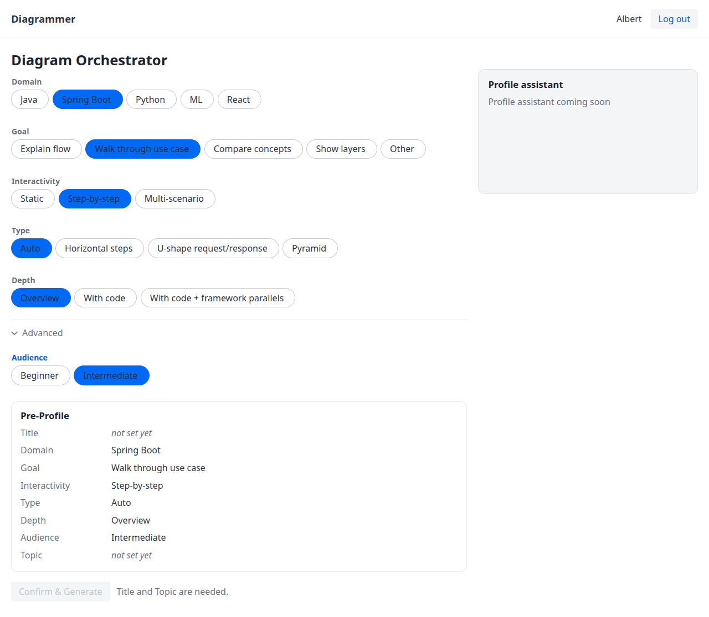
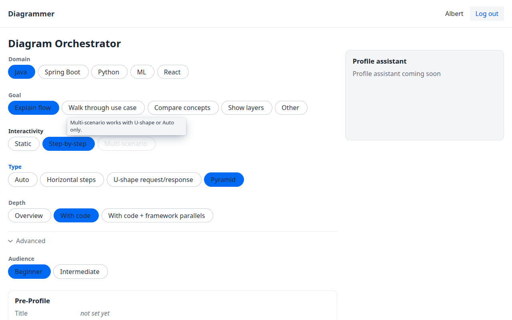
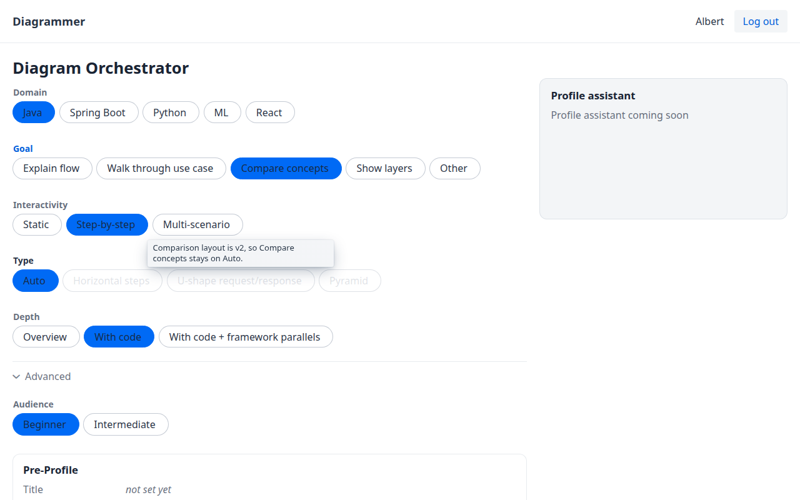

# Creating a diagram

This is the Diagram Orchestrator in release v0.0.2. Sign-in is covered in [Signing in](signing-in.md). Every chip, its label, and its stored value are listed in [Pre-Profile options](reference/pre-profile-options.md).

## The Diagram Orchestrator

After you sign in, the heading is **Diagram Orchestrator**.

The page has two columns. The left column is where you choose options: the chips, the **Pre-Profile** card, and **Confirm & Generate**. The right column is headed **Profile assistant**.

The header shows **Diagrammer**, your display name, and **Log out**. In this picture the display name is Albert, from the local fixture account.

You pick one chip in each group. The selected chip is filled. The card updates on each click. Refresh the page and the chips return to the defaults below. This release does not save the profile.

## Choose your options

The groups appear in this order. Audience sits inside **Advanced**, which is open when you arrive.

### Domain

The subject of the diagram. The default is **Java**. The other chips are **Spring Boot**, **Python**, **ML**, and **React**.

### Goal

What the diagram is for. The default is **Explain flow**. The other chips are **Walk through use case**, **Compare concepts**, **Show layers**, and **Other**.

**Other** can be selected. The card then says Other. Writing what you mean is coming later, with the Profile assistant.

### Interactivity

How the reader moves through the diagram. The default is **Step-by-step**. The other chips are **Static** and **Multi-scenario**.

**Static** and **Step-by-step** work with every type. **Multi-scenario** does not. See [Combinations that are blocked](#combinations-that-are-blocked).

### Type

The layout. The default is **Auto**. The other chips are **Horizontal steps**, **U-shape request/response**, and **Pyramid**.

There is no Comparison chip in v0.0.2.

The card shows the word Auto. It does not name a layout underneath. Suggesting one is coming later: Explain flow leads to horizontal steps, Walk through use case leads to U-shape, and Show layers leads to pyramid. Compare concepts has no layout to suggest yet.

### Depth

How much detail the diagram carries. The default is **With code**. The other chips are **Overview** and **With code + framework parallels**.

### Audience

Who the diagram is for. This group is under **Advanced**. The default is **Beginner**. The other chip is **Intermediate**.

## The Pre-Profile card

The card is titled **Pre-Profile**. It has eight rows: **Title**, **Domain**, **Goal**, **Interactivity**, **Type**, **Depth**, **Audience**, and **Topic**.

Title and Topic say **not set yet**. The other rows show the label of the chip you picked, not the shorter stored value. Those stored values are in the [reference](reference/pre-profile-options.md).

Changing Domain, Goal, Depth, and Audience updates those four rows. In this picture the card reads Spring Boot, Walk through use case, Overview, and Intermediate. Interactivity and Type are still the defaults, Step-by-step and Auto.

## Combinations that are blocked

A blocked chip is greyed out. You cannot select it. Hold the pointer on it and a note says why.

### Pyramid or Horizontal steps with Multi-scenario

**Multi-scenario** works only with **U-shape request/response** or **Auto**. The note says:

> Multi-scenario works with U-shape or Auto only.

With **Pyramid** selected, **Multi-scenario** is greyed out:

**Horizontal steps** blocks **Multi-scenario** in the same way, with the same note.

The other way around is the same rule. If **Multi-scenario** is selected, **Pyramid** and **Horizontal steps** are greyed out, and the same note appears. **U-shape request/response** and **Auto** stay available. **Static** and **Step-by-step** stay available with every type.

### Compare concepts keeps Type on Auto

**Compare concepts** sets **Type** to **Auto**. **Horizontal steps**, **U-shape request/response**, and **Pyramid** are greyed out. If one of those was already selected, Type moves back to Auto. The note says:

> Comparison layout is v2, so Compare concepts stays on Auto.

"v2" in that note means a later layout. It is not diagram version v2, and it is not release v0.0.2.

## Title

Coming later (S3). The card already has a **Title** row, and it says **not set yet**. You will type the title yourself. In v0.0.2 that row is the only place the title appears.

## Topic

The right-hand panel is headed **Profile assistant**. The only line in it is **Profile assistant coming soon**.

Coming later (S4), that assistant asks for the topic: one sentence about the diagram. Until then the **Topic** row says **not set yet**.

## Theme and rendering

Coming later.

Diagrams will support a light theme and a dark theme (S15). Neither theme is a chip on this screen.

The usual path will fill a template. You will be able to ask a model to render instead (S16). That choice is not on this screen.

## Confirm & Generate

The button is **Confirm & Generate**. It is disabled. Next to it, the hint reads:

> Title and Topic are needed.

Both of those rows still say **not set yet**, so the button stays disabled for this whole release. The hint is on the same page as the chips, under the Pre-Profile card. It is included in the [first Diagram Orchestrator picture](#the-diagram-orchestrator).

## The result

Coming later (S11). v0.0.2 does not open a diagram page, and **Confirm & Generate** does not start one.

## If generation fails

Coming later. This release does not call the generator, so there is no generation error to show. A wrong username or password is described in [Signing in](signing-in.md).

## Sharing

Coming later (S9). A diagram link will be public: anyone with the link can view the diagram, without signing in. The exact address is not settled, so this guide does not show one.

Viewing each layout, and working with versions, are separate pages. Both are coming later. The list is on the [user guide home](README.md).
