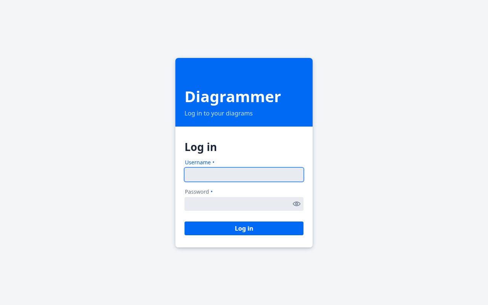
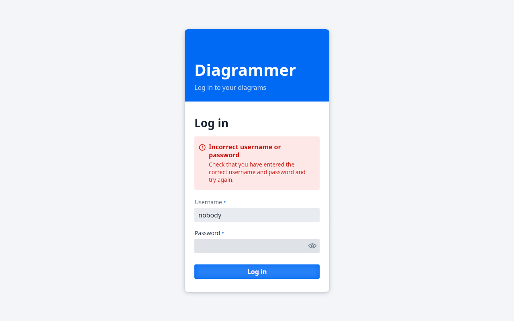

# Signing in

Release v0.0.1 added sign-in. It is unchanged in v0.0.2.

## Open Diagrammer

The public app is [https://diagrammer-wt9s.onrender.com](https://diagrammer-wt9s.onrender.com). If it has been idle, the first response can take a moment.

When you are not signed in, Diagrammer shows the login screen.

A local run is covered in the [application README](../../diagrammer-code-project/README.md). The pictures here were taken on that local run. The account's display name is Albert.

## The login screen

The screen is a panel titled **Diagrammer**, with the line **Log in to your diagrams**.

The fields are **Username** and **Password**. The button is **Log in**. The password box in this picture is empty. There is no forgot-password link and no sign-up form.

## Sign in

Type the username and password for your account, then press **Log in**.

The next screen is the [Diagram Orchestrator](creating-a-diagram.md). The header shows **Diagrammer**, your display name, and **Log out**.

## If the username or password is wrong

You stay on the login screen. A message appears:

**Incorrect username or password**

Check that you have entered the correct username and password and try again.

## Log out

**Log out** is in the header, next to your display name. After you log out, you are back on the login screen.

## Who can sign in

Diagrammer does not offer sign-up. Someone adds your account.

On the deployed app, accounts are listed in `auth/users.json`. On a local run, the application README explains the fixture account. That password is only for the local run.
